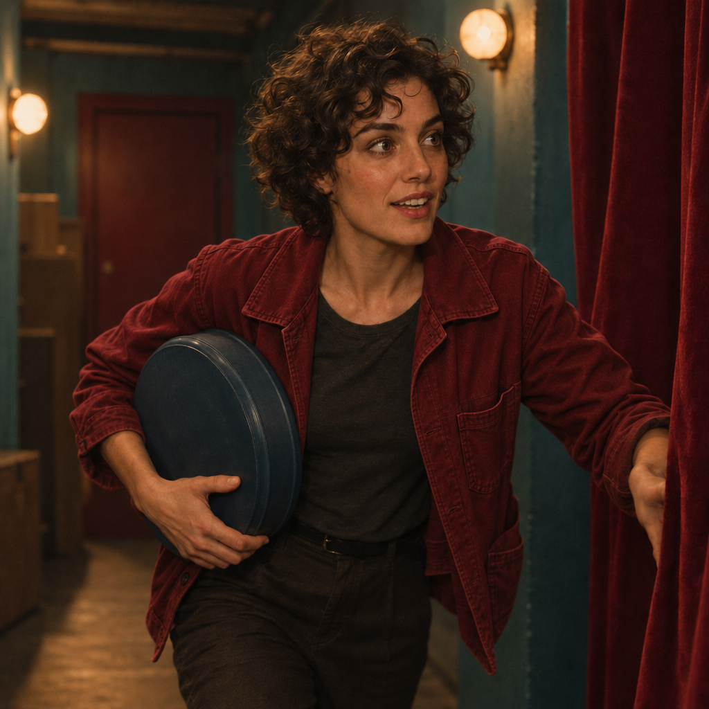
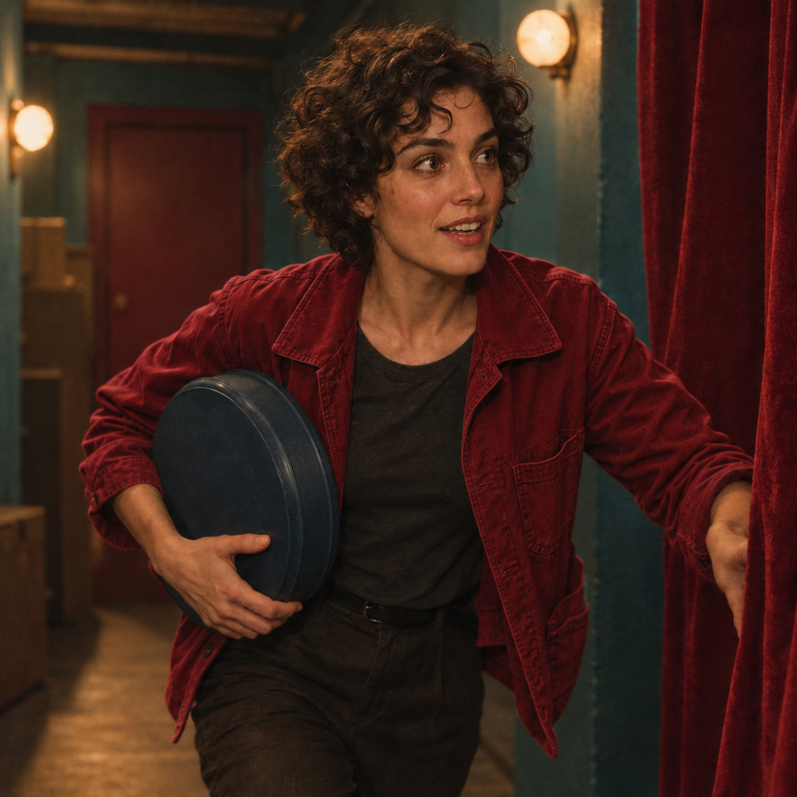

<!-- Generated by scripts/build_readme.py. Edit source data, locale catalogs and generator scripts. -->

# The Last Reel: shared-input wardrobe edits

[← Back to external website archive](../../README.md#all-cases)

 

**Creator-reported model · Source-only; not independently reproduced**

Both edits use the same Flare-generated ochre-jacket image from The Last Reel generation case, not a separate Sunburst input. They change the jacket to deep red while broadly retaining the scene and pose; exact pixel or identity preservation is not claimed. The shared input is already archived with the generation case, so only the two new edit outputs are stored here. All four originals retain their embedded content credentials; signatures were not authenticated and generic gpt-image metadata does not establish the version or variant.

## Images / GIFs

- [Sunburst wardrobe edit: deep red jacket in the shared Flare cinema scene.](https://media.maxvideoai.com/model-launch/gpt-image-2-6/2026-11-05/30fc5d0b0da3670745c399c57b3e7094eb8682a19cdd1ebec444f2d63179020e.png) · image
  - Credit: MaxVideoAI public example; individual creator not named
  - Reuse: source-attributed. Unmodified public example with exact source attribution. No third-party redistribution license was found. The provider’s showcase rights do not grant this collection permission; attribution is not a license and the repository MIT license does not cover the image.
  - [Provenance / rights evidence](https://maxvideoai.com/models/gpt-image-2-6-sunburst)

- [Flare wardrobe edit: deep red jacket in the shared Flare cinema scene.](https://media.maxvideoai.com/model-launch/gpt-image-2-6/2026-11-05/7262fb83e45d95abc474d1f7d9c161c119129e09aa690e9633635c7868cce9af.png) · image
  - Credit: MaxVideoAI public example; individual creator not named
  - Reuse: source-attributed. Unmodified public example with exact source attribution. No third-party redistribution license was found. The provider’s showcase rights do not grant this collection permission; attribution is not a license and the repository MIT license does not cover the image.
  - [Provenance / rights evidence](https://maxvideoai.com/models/gpt-image-2-6-sunburst)
- [Shared input: the Flare generation archived in The Last Reel scene-variants case.](https://media.maxvideoai.com/model-launch/gpt-image-2-6/2026-11-05/5c1807810678c1a1436ee1655bf694358709f37013b8d192d9b90f0f9b6d946a.png) · image
  - Credit: MaxVideoAI public example
  - Reuse: link-only. This is the same original already stored in the generation case, not a fifth distinct file. This record links the input without a duplicate local copy. The provider maps both edits to it; attribution does not establish reuse permission.
  - [Provenance / rights evidence](https://maxvideoai.com/models/gpt-image-2-6-sunburst)

## Source-page and media access

- Checked: 2026-11-08 (UTC)
- Original page: Accessible. The already-known original provider page was read on 2026-11-08 to verify the existing local case. No new case search or generation was performed.
- Media: Partially archived. All retained original files were hash-checked, decoded and visually reviewed. No private QA derivative is published. The MaxVideoAI edit reference remains stored once in its generation case.
- [Per-file attempts and results](../../../docs/DESIGNARENA_PROVIDERS_RECOVERY_AUDIT_2026-11-08.md)

## Original prompt

[Original prompt at source](https://maxvideoai.com/models/gpt-image-2-6-sunburst)

The source publishes the actual prompt. This repository links to it rather than inventing or republishing the full text. Required inputs and parameters remain at the source.

## Attribution and verification

- ID: maxvideo-gpt26-last-reel-edit
- Author: MaxVideoAI (publisher; individual creator not named)
- [Original source](https://maxvideoai.com/models/gpt-image-2-6-sunburst)
- Model: GPT Image 2.6
- Variant: Flare / Sunburst
- Evidence: The original MaxVideoAI Sunburst and Flare pages identify these specific gallery outputs by named engine, title, exact original file and public request. The retained file hashes match those public records. This is provider-reported model attribution, not an independently reproduced generation or served-model verification.
- Collected: 2026-11-06 (UTC)
- Source checked: 2026-11-08 (UTC)

Attribution does not grant a media license. Repository MIT terms do not cover third-party outputs. Local files record provenance and reuse status; source-attributed does not mean open-licensed.
