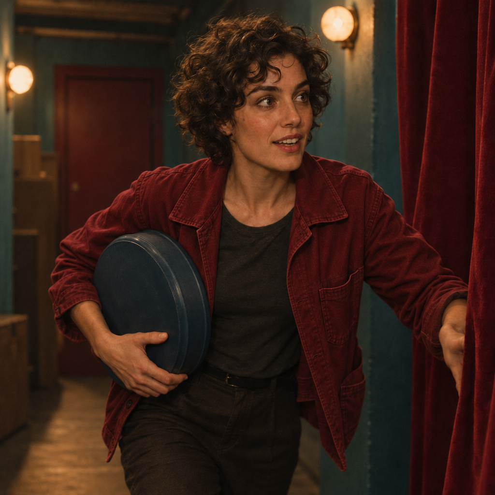
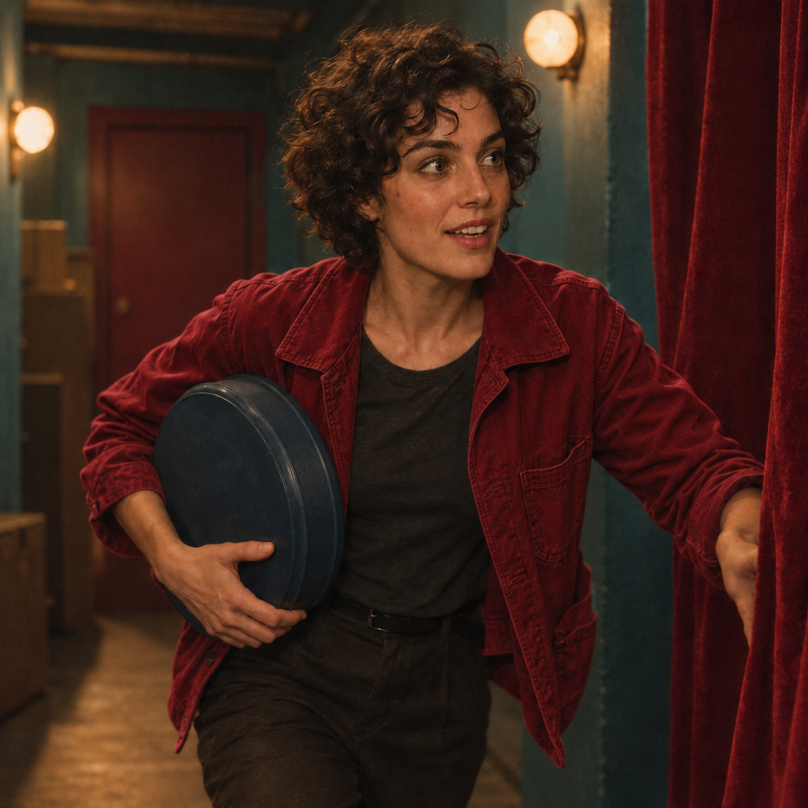

<!-- Generated by scripts/build_readme.py. Edit source data, locale catalogs and generator scripts. -->

# 《最后一卷胶片》：共同输入的服装编辑

[← 返回外站素材目录](../../README.md#all-cases)

 

**作者自报模型 · 仅核对来源；未独立复现**

两次编辑都使用《最后一卷胶片》生成案例中的同一张 Flare 赭色外套图，而非分别使用 Sunburst 输入。结果将外套改为深红色，大体保留场景及姿态；不宣称逐像素或身份完全一致。共同输入已在生成案例中存档，此处仅存储两份新编辑输出。四份原始文件均保留嵌入的内容凭证，未认证签名，通用 gpt-image 元数据不证明具体版本或变体。

## 图片 / GIF

- [Sunburst 服装编辑：共同 Flare 影院场景中的深红色外套。](https://media.maxvideoai.com/model-launch/gpt-image-2-6/2026-11-05/30fc5d0b0da3670745c399c57b3e7094eb8682a19cdd1ebec444f2d63179020e.png) · image
  - 署名：MaxVideoAI public example; individual creator not named
  - 使用条件：source-attributed. 原样保留公开示例并注明准确来源。未找到授予第三方的转载许可证。服务商的展示权不等于本合集获得授权；署名不等于许可，仓库 MIT 许可不覆盖图片。
  - [来源 / 权利依据](https://maxvideoai.com/models/gpt-image-2-6-sunburst)

- [Flare 服装编辑：共同 Flare 影院场景中的深红色外套。](https://media.maxvideoai.com/model-launch/gpt-image-2-6/2026-11-05/7262fb83e45d95abc474d1f7d9c161c119129e09aa690e9633635c7868cce9af.png) · image
  - 署名：MaxVideoAI public example; individual creator not named
  - 使用条件：source-attributed. 原样保留公开示例并注明准确来源。未找到授予第三方的转载许可证。服务商的展示权不等于本合集获得授权；署名不等于许可，仓库 MIT 许可不覆盖图片。
  - [来源 / 权利依据](https://maxvideoai.com/models/gpt-image-2-6-sunburst)
- [共同输入：《最后一卷胶片》场景版本案例中已存档的 Flare 生成图。](https://media.maxvideoai.com/model-launch/gpt-image-2-6/2026-11-05/5c1807810678c1a1436ee1655bf694358709f37013b8d192d9b90f0f9b6d946a.png) · image
  - 署名：MaxVideoAI public example
  - 使用条件：link-only. 这是已存储于生成案例中的同一份原始文件，并非第五份不同文件。此记录链接输入，不重复存储本地副本。服务商将两次编辑均对应到该图；署名不构成使用授权。
  - [来源 / 权利依据](https://maxvideoai.com/models/gpt-image-2-6-sunburst)

## 原帖与素材获取状态

- 核对日期：2026-11-08 (UTC)
- 原帖：可打开. 2026-11-08打开已知服务商原页，为既有本地案例补证，未搜索新案例或执行生成。
- 素材：部分入库. 留存原文件均核对哈希、完整解码并目视审核，不发布私有质检派生图。MaxVideoAI编辑的共同输入仅在生成案例中保存一次。
- [逐项尝试与结果](../../../docs/DESIGNARENA_PROVIDERS_RECOVERY_AUDIT_2026-11-08.md)

## 原始提示词

[原提示词见来源](https://maxvideoai.com/models/gpt-image-2-6-sunburst)

来源公开了真实提示词。本仓库链接原文，不伪造或转载完整长提示词；所需输入与参数请在原文查看。

## 来源与核对信息

- ID: maxvideo-gpt26-last-reel-edit
- 作者：MaxVideoAI (publisher; individual creator not named)
- [原始来源](https://maxvideoai.com/models/gpt-image-2-6-sunburst)
- 模型：GPT Image 2.6
- 版本：Flare / Sunburst
- 依据：MaxVideoAI 的 Sunburst 与 Flare 原始页面用具体引擎名称、标题、准确原始文件及公开请求标注这些图库输出。留存文件哈希与公开记录一致。这是服务商自述的模型归因，并非独立复现生成或核实实际服务模型。
- 收录：2026-11-06 (UTC)
- 来源核对：2026-11-08 (UTC)

标注来源不等于取得素材许可。仓库 MIT 协议不覆盖第三方输出；本地素材逐项记录来源与使用状态，source-attributed 不代表开放许可。
