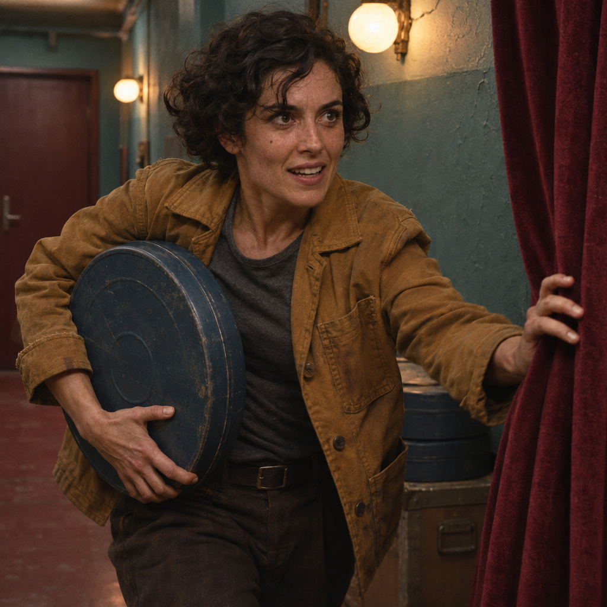
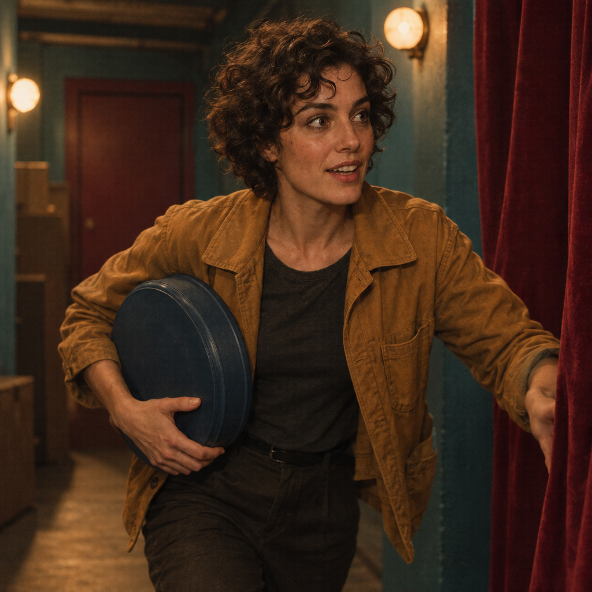

<!-- Generated by scripts/build_readme.py. Edit source data, locale catalogs and generator scripts. -->

# The Last Reel: Flare and Sunburst scene variants

[← Back to external website archive](../../README.md#all-cases)

 

**Creator-reported model · Source-only; not independently reproduced**

Two variants of one cinematic still task, not two separate cases. The 1024 × 1024 original PNGs show an adult fictional character in an ochre jacket holding a film canister in a cinema corridor. The renders differ in pose, framing and details. The Flare generation is also the shared input for both wardrobe edits; the Sunburst generation is not an edit input. The source reports high quality and high planning. Original requests remain at the source; no comparative speed or quality benchmark is claimed.

## Images / GIFs

- [Sunburst generation: fictional adult woman in an ochre jacket holding a blue film canister beside a burgundy curtain.](https://media.maxvideoai.com/model-launch/gpt-image-2-6/2026-11-05/dd2a1bb8824ff1f64033db2c7ef459954b0001cba581f6764ceecad6be9d1d7b.png) · image
  - Credit: MaxVideoAI public example; individual creator not named
  - Reuse: source-attributed. Unmodified public example with exact source attribution. No third-party redistribution license was found. The provider’s showcase rights do not grant this collection permission; attribution is not a license and the repository MIT license does not cover the image.
  - [Provenance / rights evidence](https://maxvideoai.com/models/gpt-image-2-6-sunburst)

- [Flare generation: fictional adult woman in an ochre jacket holding a blue film canister beside a burgundy curtain.](https://media.maxvideoai.com/model-launch/gpt-image-2-6/2026-11-05/5c1807810678c1a1436ee1655bf694358709f37013b8d192d9b90f0f9b6d946a.png) · image
  - Credit: MaxVideoAI public example; individual creator not named
  - Reuse: source-attributed. Unmodified public example with exact source attribution. No third-party redistribution license was found. The provider’s showcase rights do not grant this collection permission; attribution is not a license and the repository MIT license does not cover the image.
  - [Provenance / rights evidence](https://maxvideoai.com/models/gpt-image-2-6-sunburst)

## Source-page and media access

- Checked: 2026-11-08 (UTC)
- Original page: Accessible. The already-known original provider page was read on 2026-11-08 to verify the existing local case. No new case search or generation was performed.
- Media: Archived locally. All retained original files were hash-checked, decoded and visually reviewed. No private QA derivative is published. The MaxVideoAI edit reference remains stored once in its generation case.
- [Per-file attempts and results](../../../docs/DESIGNARENA_PROVIDERS_RECOVERY_AUDIT_2026-11-08.md)

## Original prompt

[Original prompt at source](https://maxvideoai.com/models/gpt-image-2-6-sunburst)

The source publishes the actual prompt. This repository links to it rather than inventing or republishing the full text. Required inputs and parameters remain at the source.

## Attribution and verification

- ID: maxvideo-gpt26-last-reel-generation
- Author: MaxVideoAI (publisher; individual creator not named)
- [Original source](https://maxvideoai.com/models/gpt-image-2-6-sunburst)
- Model: GPT Image 2.6
- Variant: Flare / Sunburst
- Evidence: The original MaxVideoAI Sunburst and Flare pages identify these specific gallery outputs by named engine, title, exact original file and public request. The retained file hashes match those public records. This is provider-reported model attribution, not an independently reproduced generation or served-model verification.
- Collected: 2026-11-06 (UTC)
- Source checked: 2026-11-08 (UTC)

Attribution does not grant a media license. Repository MIT terms do not cover third-party outputs. Local files record provenance and reuse status; source-attributed does not mean open-licensed.
