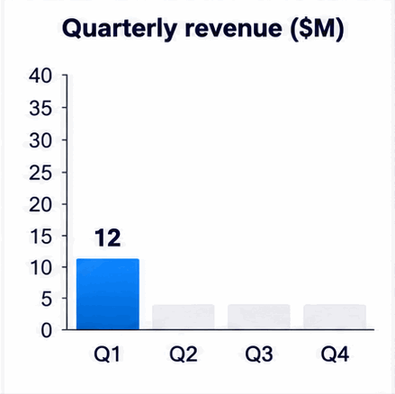
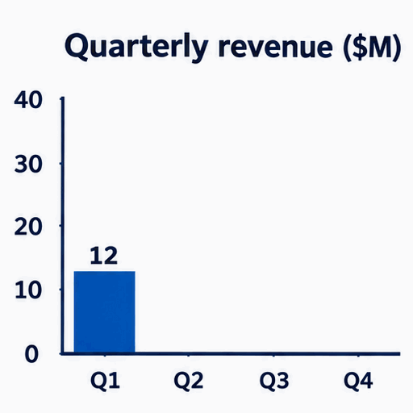
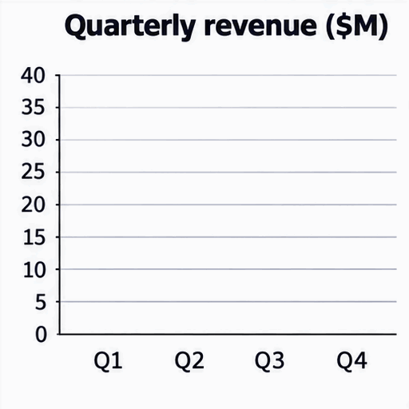

<!-- Generated by scripts/build_readme.py. Edit source data, locale catalogs and generator scripts. -->

# Quarterly revenue chart animation

[← Back to external website archive](../../README.md#all-cases)

 

**Creator-reported model · Source-only; not independently reproduced**

Source reports approximate final bar-height errors: app about one unit short for Q1–Q3, Flare up to 0.7, Sunburst within 0.2. These measurements are publisher claims, not independently remeasured. Grey app placeholder bars and unlabelled Sunburst intermediate heights remain visible; treat as illustration, not exact data. One run per prompt/surface in a small publisher test, not a benchmark. Exact public instructions remain at source; no generations were run. App model must not be inferred from API labels. Offline recovery recheck on 2026-11-08 confirms retained source mapping and original file integrity, not backend execution or current availability.

## Images / GIFs

- [ChatGPT app (underlying variant unspecified): ChatGPT app GIF: a blue bar chart growing to 12, 18, 27 and 35, with grey placeholder bars](https://nowrap.ai/reviews/chatgpt-images-2-6/app-chart.gif) · gif
  - Credit: Nowrap
  - Reuse: source-attributed. Unmodified public-source archival copy. No explicit redistribution license verified. Attribution is not permission; repository MIT licensing does not cover this media.
  - [Provenance / rights evidence](https://nowrap.ai/tools/chatgpt-images-2-6)

- [API Flare: API Flare GIF: a bar chart that grows to 12, 18, 27 and 35, then sweeps a highlight across the last bar](https://nowrap.ai/reviews/chatgpt-images-2-6/api-flare-chart.gif) · gif
  - Credit: Nowrap
  - Reuse: source-attributed. Unmodified public-source archival copy. No explicit redistribution license verified. Attribution is not permission; repository MIT licensing does not cover this media.
  - [Provenance / rights evidence](https://nowrap.ai/tools/chatgpt-images-2-6)

- [API Sunburst: API Sunburst GIF: a bar chart whose bars grow in stages to 12, 18, 27 and 35](https://nowrap.ai/reviews/chatgpt-images-2-6/api-sunburst-chart.gif) · gif
  - Credit: Nowrap
  - Reuse: source-attributed. Unmodified public-source archival copy. No explicit redistribution license verified. Attribution is not permission; repository MIT licensing does not cover this media.
  - [Provenance / rights evidence](https://nowrap.ai/tools/chatgpt-images-2-6)

## Source-page and media access

- Checked: 2026-11-05 (UTC)
- Original page: Accessible. Historical source access is recorded for 2026-11-05. Retained original source evidence was rechecked offline on 2026-11-08; no current availability check was made.
- Media: Archived locally. Retained original bytes were rechecked by SHA-256, byte length and full decoding on 2026-11-08. Every GIF frame and each distinct MP4 frame was inspected as still frames; this is not new timed playback or an online access test.
- [Per-file attempts and results](../../../docs/NOWRAP_CELLCOG_TOONDERLY_RECOVERY_AUDIT_2026-11-08.md)

## Original prompt

[Original prompt at source](https://nowrap.ai/tools/chatgpt-images-2-6)

The source publishes the actual prompt. This repository links to it rather than inventing or republishing the full text. Required inputs and parameters remain at the source.

## Attribution and verification

- ID: nowrap-chart-motion
- Author: Nowrap
- [Original source](https://nowrap.ai/tools/chatgpt-images-2-6)
- Model: GPT Image 2.6
- Variant: Flare / Sunburst
- Evidence: Nowrap’s November 5, 2026 hands-on test labels API outputs Flare and Sunburst. These known variants apply only to API media; the ChatGPT Plus app’s underlying variant is explicitly unknown. Publisher attribution, not independent generation verification.
- Collected: 2026-11-05 (UTC)
- Source checked: 2026-11-08 (UTC)

Attribution does not grant a media license. Repository MIT terms do not cover third-party outputs. Local files record provenance and reuse status; source-attributed does not mean open-licensed.
