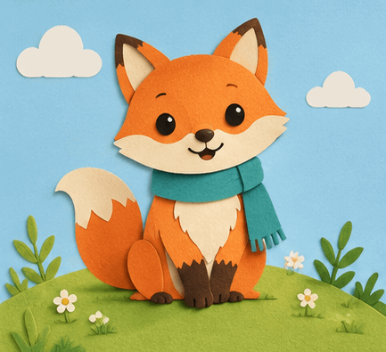

<!-- Generated by scripts/build_readme.py. Edit source data, locale catalogs and generator scripts. -->

# 剪纸狐狸挥手循环

[← 返回外站素材目录](../../README.md#all-cases)

 

**作者自报模型 · 仅核对来源；未独立复现**

精确提示词见来源。独立核查为 GIF89a：433×395、9 帧、每帧 180 毫秒、无限循环、669,897 字节；请求为每帧 200 毫秒。可见挥爪及眨眼，全部九帧已解码并审核。未执行生成。 2026-11-08离线恢复审核核对了保留的一手页面证据。提供方结果与测量不是独立基准测试。

## 图片 / GIF

- [草坡上戴青绿色围巾的剪纸狐狸挥手动画。](https://omniakey.com/blog/gpt-image-2-6-review/paper-fox.gif) · gif
  - 署名：Kiki / OmniaKey
  - 使用条件：source-attributed. 原样存档公开来源文件，未核实明确转载许可。署名不等于授权；仓库 MIT 许可不涵盖此媒体。
  - [来源 / 权利依据](https://omniakey.com/blog/gpt-image-2-6-review)

## 原帖与素材获取状态

- 核对日期：2026-11-05 (UTC)
- 原帖：可打开. 2026-11-08离线复核了2026-11-05保留的原页证据，未测试当前访问。
- 素材：已存入仓库. 已重新核对原字节、SHA-256、大小、格式和完整解码，查看每张静图与GIF全部帧；未进行新的实时播放或模型生成。
- [逐项尝试与结果](../../../docs/SOGNI_OMNIAKEY_SANDBASE_RECOVERY_AUDIT_2026-11-08.md)

## 原始提示词

[原提示词见来源](https://omniakey.com/blog/gpt-image-2-6-review)

来源公开了真实提示词。本仓库链接原文，不伪造或转载完整长提示词；所需输入与参数请在原文查看。

## 来源与核对信息

- ID: omniakey-paper-fox-loop
- 作者：Kiki, COO / OmniaKey
- [原始来源](https://omniakey.com/blog/gpt-image-2-6-review)
- 模型：GPT Image 2.6
- 版本：Sunburst
- 依据：Kiki 的 11 月 5 日原创评测展示指定 gpt-image-2.6-sunburst 的请求，并将此 GIF 归于该模型。依据创作者陈述，未独立复现。
- 收录：2026-11-05 (UTC)
- 来源核对：2026-11-08 (UTC)

标注来源不等于取得素材许可。仓库 MIT 协议不覆盖第三方输出；本地素材逐项记录来源与使用状态，source-attributed 不代表开放许可。
