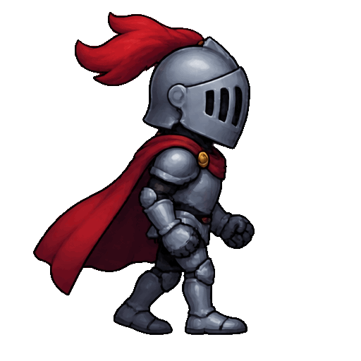

<!-- Generated by scripts/build_readme.py. Edit source data, locale catalogs and generator scripts. -->

# Red-cape knight walk cycle

[← Back to external website archive](../../README.md#all-cases)

 

**Creator-reported model · Source-only; not independently reproduced**

One publisher-generated GIF per existing case. The original adjacent prompt is linked, not reproduced. All eight frames are retained, not counted separately. Public X posts are credited by the site as ideas; these records attribute the actual served GIFs to Opusly and do not assume they are those users’ original files. No generation or timing benchmark was independently run.

## Images / GIFs

- [Armored cartoon knight walks in place on transparency.](https://www.opusly.ai/sample/gpt-image-2-6-knight.gif) · gif
  - Credit: Opusly / Lunonia Inc
  - Reuse: source-attributed. Unchanged publisher-served bytes. No explicit redistribution licence verified. Public access and attribution do not establish permission; repository MIT does not cover this media.
  - [Provenance / rights evidence](https://www.opusly.ai/gpt-image-2-6)

## Source-page and media access

- Checked: 2026-11-08 (UTC)
- Original page: Accessible. Known primary source page reopened to resolve this existing candidate; exact example labels, prompts and media URLs checked. No new case search.
- Media: Archived locally. Publisher-served files fetched successfully and preserved without modification. Formats, dimensions, hashes, full frame decoding and visual content were checked. Historical Opusly GIF hashes match; the nine other files were acquired now from already-known candidate pages.
- [Per-file attempts and results](../../../docs/MODEL_HOLDS_RECOVERY_AUDIT_2026-11-08.md)

## Original prompt

[Original prompt at source](https://www.opusly.ai/gpt-image-2-6)

The source publishes the actual prompt. This repository links to it rather than inventing or republishing the full text. Required inputs and parameters remain at the source.

## Attribution and verification

- ID: opusly-knight-loop
- Author: Opusly / Lunonia Inc
- [Original source](https://www.opusly.ai/gpt-image-2-6)
- Model: GPT Image 2.6
- Variant: Flare
- Evidence: The known page explicitly describes every displayed GIF as a real result of its adjacent prompt generated on this maker. It states the maker runs GPT Image 2.6 Flare, medium quality, and describes six test calls. The original GIF URL and historical file hash match. This is publisher attribution, not independent backend verification.
- Collected: 2026-11-05 (UTC)
- Source checked: 2026-11-08 (UTC)

Attribution does not grant a media license. Repository MIT terms do not cover third-party outputs. Local files record provenance and reuse status; source-attributed does not mean open-licensed.
