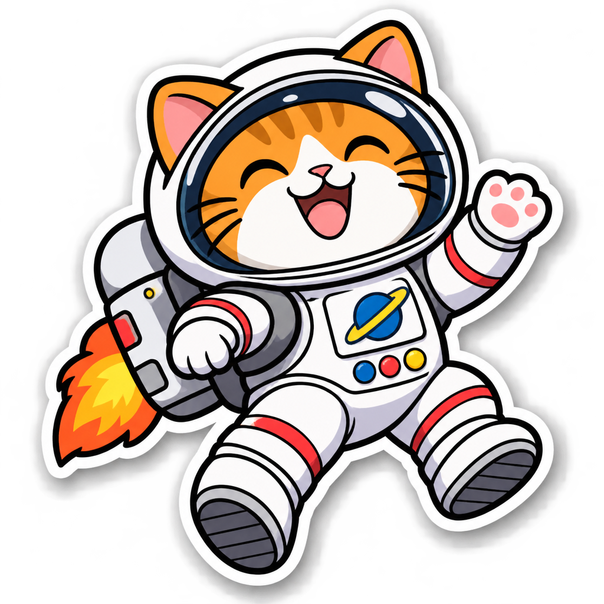

<!-- Generated by scripts/build_readme.py. Edit source data, locale catalogs and generator scripts. -->

# Astronaut cat sticker with jetpack

[← Back to external website archive](../../README.md#all-cases)

 

**Creator-reported model · Source-only; not independently reproduced**

Original 1024 × 1024 RGBA PNG. Alpha values range from 0 to 254; a transparent request is recorded, but fully opaque foreground pixels are not asserted. The source reports medium quality and complexity. This is a source-reported result, not an independent API run.

## Images / GIFs

- [Orange astronaut cat with a jetpack, white sticker border and soft surrounding shadow.](https://replicate.delivery/xezq/c4C3tbIuQQZzJVAAJ5fuSsJGnnGuAePKsNfA8UkP8w6iDz8uA/tmpougq7_hv.png) · image
  - Credit: lucataco / Replicate public example
  - Reuse: source-attributed. Original public-source media retained unchanged with attribution. No independent redistribution license has been verified. Attribution is not permission, and the repository MIT license does not cover this file.
  - [Provenance / rights evidence](https://replicate.com/openai/gpt-image-2.6-flare/examples)

## Source-page and media access

- Checked: 2026-11-08 (UTC)
- Original page: Accessible. Directly revisited the known original public page and matched each archived media URL to the current HTML or embedded prediction record. No new-case search was performed.
- Media: Archived locally. Retained original bytes were checked against recorded SHA-256 and size, fully decoded and visually inspected, including every animation/video frame. No new generation or media download was performed.
- [Per-file attempts and results](../../../docs/FIVE_SOURCES_BACKLOG_AUDIT_2026-11-08.md)

## Original prompt

[Original prompt at source](https://replicate.com/openai/gpt-image-2.6-flare/examples)

The source publishes the actual prompt. This repository links to it rather than inventing or republishing the full text. Required inputs and parameters remain at the source.

## Attribution and verification

- ID: replicate-flare-astronaut-cat-sticker
- Author: lucataco / Replicate
- [Original source](https://replicate.com/openai/gpt-image-2.6-flare/examples)
- Model: GPT Image 2.6
- Variant: Flare
- Evidence: The public Replicate examples page embeds completed prediction 85bvkc8ds1rmy0d1n5y8kwb4hc. Its input, exact output URL, creator account lucataco, ran_on model openai/gpt-image-2.6-flare and matching model log occur in the same record. This establishes source-reported attribution, not independent reproduction.
- Collected: 2026-11-06 (UTC)
- Source checked: 2026-11-08 (UTC)

Attribution does not grant a media license. Repository MIT terms do not cover third-party outputs. Local files record provenance and reuse status; source-attributed does not mean open-licensed.
