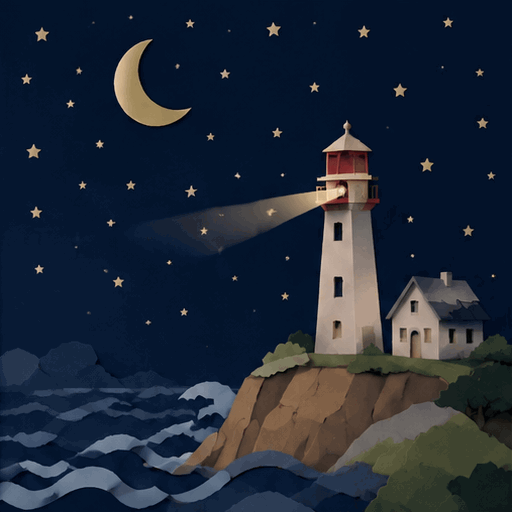

<!-- Generated by scripts/build_readme.py. Edit source data, locale catalogs and generator scripts. -->

# Paper-cut lighthouse at night: animated loop

[← Back to external website archive](../../README.md#all-cases)

 

**Creator-reported model · Source-only; not independently reproduced**

Existing historical case, now tied to an exact original prediction and credited to the recorded openai organization account. Original 512 × 512 GIF: nine distinct decoded frames, 200 ms each, 1.8 seconds per loop. All frames were inspected in sequence; no new browser playback or API generation was performed in this review. This is separate from lucataco’s landscape-format lighthouse sky edit.

## Images / GIFs

- [A paper-cut lighthouse casts a moving beam over layered waves beneath a crescent moon and stars.](https://replicate.delivery/xezq/o3pLAOaAAc7NOlPmsNnOVAZfwTvEevu7K5fG2jIxKW8ng28uA/tmpz22_l_mk.gif) · gif
  - Credit: openai organization account / Replicate public example
  - Reuse: source-attributed. Original public-source media retained unchanged with attribution. No independent redistribution license has been verified. Attribution is not permission, and the repository MIT license does not cover this file.
  - [Provenance / rights evidence](https://replicate.com/openai/gpt-image-2.6-flare/examples)

## Source-page and media access

- Checked: 2026-11-08 (UTC)
- Original page: Accessible. Directly revisited the known original public page and matched each archived media URL to the current HTML or embedded prediction record. No new-case search was performed.
- Media: Archived locally. Retained original bytes were checked against recorded SHA-256 and size, fully decoded and visually inspected, including every animation/video frame. No new generation or media download was performed.
- [Per-file attempts and results](../../../docs/FIVE_SOURCES_BACKLOG_AUDIT_2026-11-08.md)

## Original prompt

[Original prompt at source](https://replicate.com/openai/gpt-image-2.6-flare/examples)

The source publishes the actual prompt. This repository links to it rather than inventing or republishing the full text. Required inputs and parameters remain at the source.

## Attribution and verification

- ID: replicate-flare-lighthouse-loop
- Author: openai (organization account) / Replicate
- [Original source](https://replicate.com/openai/gpt-image-2.6-flare/examples)
- Model: GPT Image 2.6
- Variant: Flare
- Evidence: The public examples page embeds completed prediction ahgt8v7m0srmr0d1n7kre9zhww with the exact historical GIF output URL, original prompt, created_by organization openai, ran_on model openai/gpt-image-2.6-flare and matching model log. This is source-reported execution evidence, not an independently rerun API request.
- Collected: 2026-11-05 (UTC)
- Source checked: 2026-11-08 (UTC)

Attribution does not grant a media license. Repository MIT terms do not cover third-party outputs. Local files record provenance and reuse status; source-attributed does not mean open-licensed.
