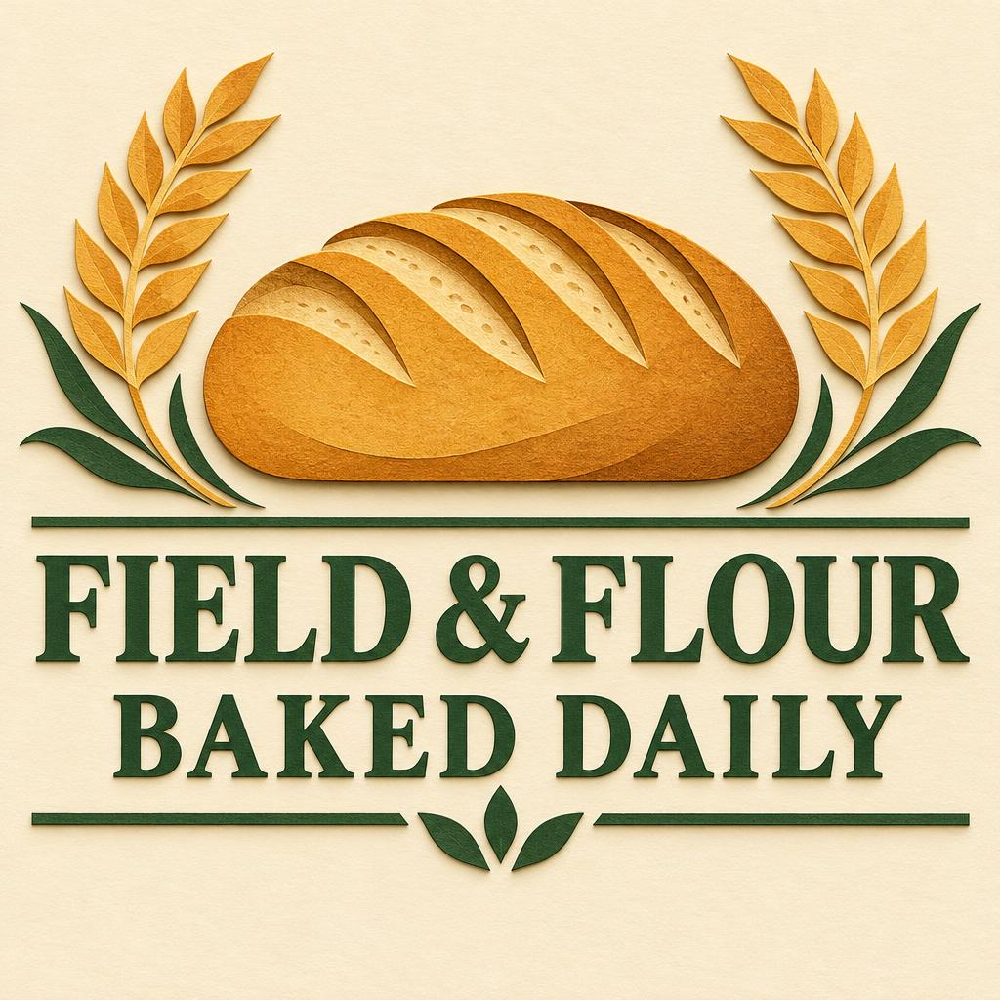

<!-- Generated by scripts/build_readme.py. Edit source data, locale catalogs and generator scripts. -->

# FIELD & FLOUR bakery poster

[← Back to external website archive](../../README.md#all-cases)

 

**Creator-reported model · Source-only; not independently reproduced**

Only the visible GPT Image 2.6 Flare bakery poster is included. The 2.5 counterpart and discussed but unattached solar-system/watch images are excluded. The reviewed source does not provide the exact bakery prompt; not-public records this observed absence, not secrecy or availability elsewhere. Offline recovery review on 2026-11-08 checked retained original HTML. Provider results and measurements are not independent benchmarks.

## Images / GIFs

- [Bread and wheat above FIELD & FLOUR BAKED DAILY on cream](https://blog.sogni.ai/blogs/gpt-image-2-6/assets/poster-26-flare.jpg) · image
  - Credit: Sogni Labs
  - Reuse: source-attributed. Public-source copy with original provider attribution. No explicit redistribution license was verified. Public availability and attribution do not grant permission; the repository MIT license does not cover this media.
  - [Provenance / rights evidence](https://blog.sogni.ai/blogs/gpt-image-2-6/)

## Source-page and media access

- Checked: 2026-11-05 (UTC)
- Original page: Accessible. Original page evidence collected on 2026-11-05 was rechecked offline on 2026-11-08. Current access was not tested.
- Media: Archived locally. Original bytes, SHA-256, byte counts, formats and full decoding were rechecked. Every static image and GIF frame was visually reviewed; no new timed playback or generation was performed.
- [Per-file attempts and results](../../../docs/SOGNI_OMNIAKEY_SANDBASE_RECOVERY_AUDIT_2026-11-08.md)

## Original prompt

**PLACEHOLDER: prompt not publicly provided.**

## Attribution and verification

- ID: sogni-flare-bakery-poster
- Author: Sogni Labs
- [Original source](https://blog.sogni.ai/blogs/gpt-image-2-6/)
- Model: GPT Image 2.6
- Variant: Flare
- Evidence: The individual caption reads GPT Image 2.6 Flare · Medium. Sogni Labs reports one take per prompt, 1024 square JPEG, Medium quality and High planning complexity through serial OpenAI Images API calls on November 4, 2026 PT.
- Collected: 2026-11-05 (UTC)
- Source checked: 2026-11-08 (UTC)

Attribution does not grant a media license. Repository MIT terms do not cover third-party outputs. Local files record provenance and reuse status; source-attributed does not mean open-licensed.
