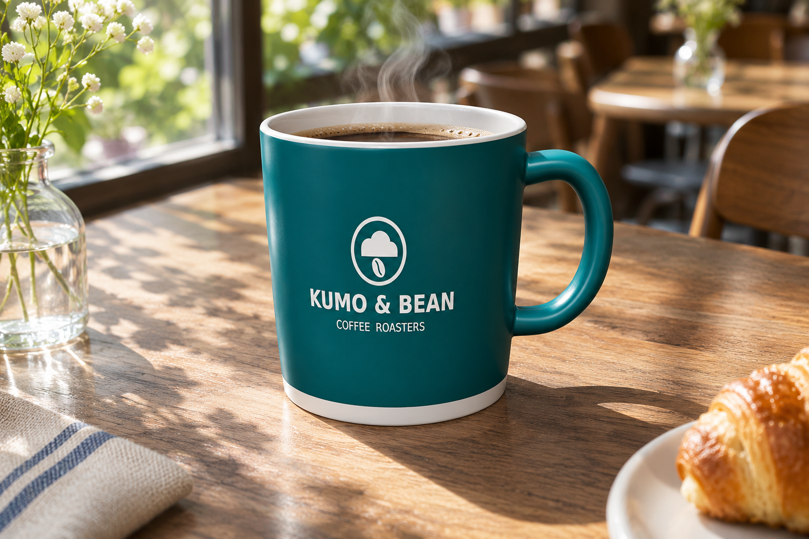
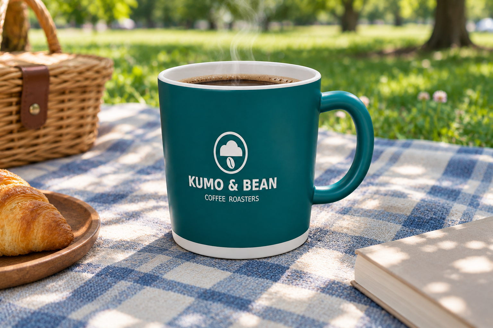
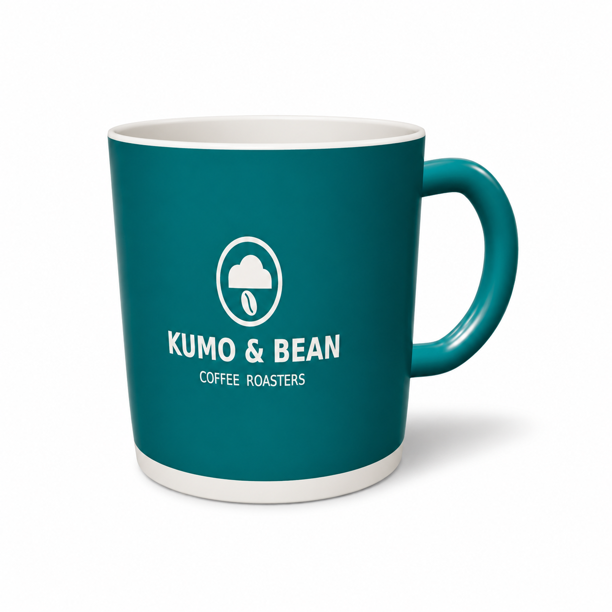
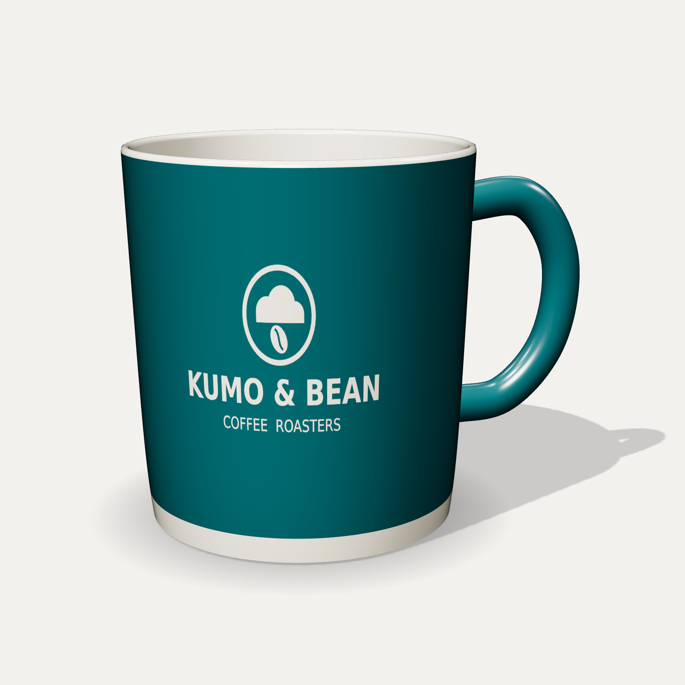

<!-- Generated by scripts/build_readme.py. Edit source data, locale catalogs and generator scripts. -->

# 保存马克杯参考图并复用于三个场景

[← 返回外站素材目录](../../README.md#all-cases)

 

**作者自报模型 · 仅核对来源；未独立复现**

同一组参考图复用案例，不拆成三项测试：咖啡馆木桌、公园野餐及白底方形电商图。来源折叠区域公开了三条日文提示词。来源称颜色、标志和形状得到保留，同时指出咖啡馆与野餐结果在未要求时加入了咖啡。马克杯参考图仅作为输入，不另计 2.6 输出。未独立运行生成。

## 图片 / GIF

- [装有咖啡的青绿色 KUMO & BEAN 马克杯，置于阳光照射的咖啡馆木桌上](https://weel.co.jp/wp-content/uploads/%E6%9C%9D%E3%81%AE%E9%99%BD%E3%81%A0%E3%81%BE%E3%82%8A%E3%81%A8%E3%82%AF%E3%83%A2%EF%BC%86%E3%83%93%E3%83%BC%E3%83%B3%E3%81%AE%E3%83%9E%E3%82%B0.png) · image
  - 署名：WEEL (ウィール) / WEEL Inc.
  - 使用条件：source-attributed. 公开案例按原样存档并保留来源署名，未核实明确转载许可证。署名和公开可见性不等于授权，仓库 MIT 许可不覆盖此媒体；角色、商标等第三方权利可能另行适用。
  - [来源 / 权利依据](https://weel.co.jp/media/tech/chatgpt-images-2-6/#index_id27)

- [装有咖啡的青绿色品牌马克杯，置于格纹野餐毯上](https://weel.co.jp/wp-content/uploads/%E6%9C%A8%E6%BC%8F%E3%82%8C%E6%97%A5%E3%81%AE%E3%83%94%E3%82%AF%E3%83%8B%E3%83%83%E3%82%AF%E3%82%B3%E3%83%BC%E3%83%92%E3%83%BC.png) · image
  - 署名：WEEL (ウィール) / WEEL Inc.
  - 使用条件：source-attributed. 公开案例按原样存档并保留来源署名，未核实明确转载许可证。署名和公开可见性不等于授权，仓库 MIT 许可不覆盖此媒体；角色、商标等第三方权利可能另行适用。
  - [来源 / 权利依据](https://weel.co.jp/media/tech/chatgpt-images-2-6/#index_id27)

- [青绿色品牌马克杯的白底电商缩略图](https://weel.co.jp/wp-content/uploads/%E7%99%BD%E3%81%84%E8%83%8C%E6%99%AF%E3%81%AE%E3%83%86%E3%82%A3%E3%83%BC%E3%83%AB%E3%83%9E%E3%82%B0%E3%80%8CKUMO-BEAN%E3%80%8D.png) · image
  - 署名：WEEL (ウィール) / WEEL Inc.
  - 使用条件：source-attributed. 公开案例按原样存档并保留来源署名，未核实明确转载许可证。署名和公开可见性不等于授权，仓库 MIT 许可不覆盖此媒体；角色、商标等第三方权利可能另行适用。
  - [来源 / 权利依据](https://weel.co.jp/media/tech/chatgpt-images-2-6/#index_id27)

**参考 / 输入图，不是生成结果。**

- [参考输入：浅色背景上的青绿色 KUMO & BEAN 马克杯](https://weel.co.jp/wp-content/uploads/mug.png) · image
  - 署名：WEEL (ウィール) / WEEL Inc.
  - 使用条件：source-attributed. 公开案例按原样存档并保留来源署名，未核实明确转载许可证。署名和公开可见性不等于授权，仓库 MIT 许可不覆盖此媒体；角色、商标等第三方权利可能另行适用。
  - [来源 / 权利依据](https://weel.co.jp/media/tech/chatgpt-images-2-6/#index_id27)

## 原帖与素材获取状态

- 核对日期：2026-11-08 (UTC)
- 原帖：可打开. 既有原文返回 HTTP 200，作者本人实测章节将本案例、提示词及媒体对应到 Images 2.6 测试；具体版本未公开。
- 素材：已存入仓库. 可正常访问的原件已对应准确页面地址、再次取回逐字节比对、解码并目视检查；仅链接的例外逐文件说明。未独立复现生成。
- [逐项尝试与结果](../../../docs/WEEL_STRUGGLE_SOURCE_AUDIT_2026-11-08.md)

## 原始提示词

[原提示词见来源](https://weel.co.jp/media/tech/chatgpt-images-2-6/#index_id27)

来源公开了真实提示词。本仓库链接原文，不伪造或转载完整长提示词；所需输入与参数请在原文查看。

## 来源与核对信息

- ID: weel-saved-mug-scenes
- 作者：WEEL (ウィール) / WEEL Inc.
- [原始来源](https://weel.co.jp/media/tech/chatgpt-images-2-6/#index_id27)
- 模型：GPT Image 2.6
- 版本：版本未注明
- 依据：WEEL 将实测章节标为“ChatGPT Images 2.6を実際に使って検証してみた”，并称把马克杯参考图保存为“マグ”，随后在新对话中调用并生成三个场景。文章给出了输入图、三条独立提示词和三张结果。这是发布者的模型归因，未披露底层 Flare/Sunburst 版本。
- 收录：2026-11-05 (UTC)
- 来源核对：2026-11-08 (UTC)

标注来源不等于取得素材许可。仓库 MIT 协议不覆盖第三方输出；本地素材逐项记录来源与使用状态，source-attributed 不代表开放许可。
