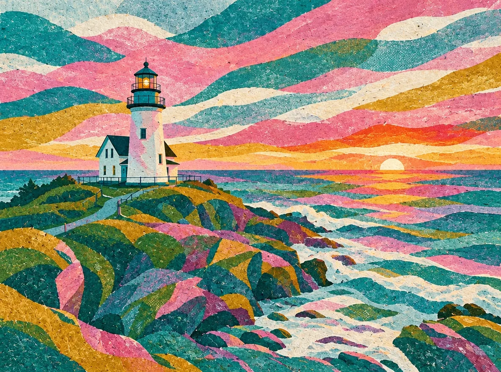

<!-- Generated by scripts/build_readme.py. Edit source data, locale catalogs and generator scripts. -->

# 借用参考图风格

[← 返回外站素材目录](../../README.md#all-cases)

 

**作者自报模型 · 仅核对来源；未独立复现**

仅存档公开的 GPT Image 2.6 结果。参考照片及 Nano Banana 对照不作为本例模型输出，也未复制。页面链接到单独的提示词页，但本次恢复核验未检查该独立页面及准确措辞，因此标为提示词公开状态待核验。未从图片或标题反推提示词。各例对应独立参考照片与任务，不按变体或帧拆分。来源称八项涂抹编辑使用自动绘制的引导遮罩而非新 markup 层；未独立确认逐例遮罩分配。

## 图片 / GIF

- [色彩丰富、带纹理的海岸灯塔插画。](https://yepshot.com/explore/compose-style-transfer-after-gpt26.webp) · image
  - 署名：YepShot
  - 使用条件：source-attributed. 公开发表文件的原样副本。未核实明确转载许可。署名不等于授权，仓库 MIT 许可不覆盖此素材。
  - [来源 / 权利依据](https://yepshot.com/nano-banana-2-1-vs-gpt-image-2-6)

## 原帖与素材获取状态

- 核对日期：2026-11-08 (UTC)
- 原帖：可打开. 仅重新打开已知原文为既有留存案例补证，核对模型标签及原始媒体地址，并披露GIF改为WebP的来源变化，未搜索新案例。
- 素材：已存入仓库. 所有留存原始素材地址均返回HTTP 200，SHA-256及字节数匹配。静图及动画全部帧完成解码与目视核验，SVG完成安全检查及渲染。仅链接的编辑参考图不算另一份已存档输出。
- [逐项尝试与结果](../../../docs/AIVIDEOS_YEPSHOT_RECOVERY_AUDIT_2026-11-08.md)

## 原始提示词

**提示词公开状态待核验**

尚未核实原始提示词是否公开。原始来源见下方署名信息。

## 来源与核对信息

- ID: yepshot-compose-style-transfer
- 作者：YepShot
- [原始来源](https://yepshot.com/nano-banana-2-1-vs-gpt-image-2-6)
- 模型：GPT Image 2.6
- 版本：Flare
- 依据：2026-11-08重新打开的原始比较页将本原尺寸文件链接逐项标为 GPT Image 2.6 结果。更新后的方法说明称2026-11-06经 fal.ai 运行一次 Flare、medium质量、自动宽高比1K编辑，补足了旧留存文章仅描述2.5测试的证据缺口。此为发布方自述，未经独立验证后端调用。
- 收录：2026-11-06 (UTC)
- 来源核对：2026-11-08 (UTC)

标注来源不等于取得素材许可。仓库 MIT 协议不覆盖第三方输出；本地素材逐项记录来源与使用状态，source-attributed 不代表开放许可。
