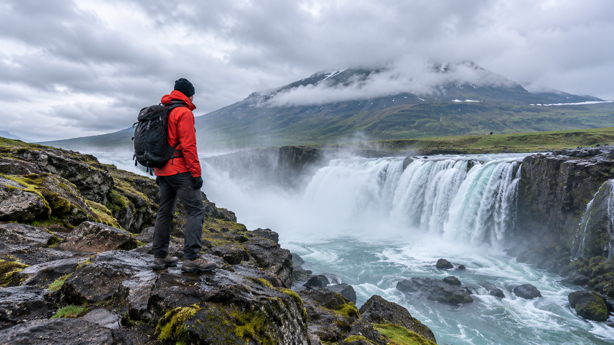

<!-- Generated by scripts/build_readme.py. Edit source data, locale catalogs and generator scripts. -->

# 瀑布与徒步者合成风景

[← 返回外站素材目录](../../README.md#all-cases)

 

**作者自报模型 · 仅核对来源；未独立复现**

案例依据创作者或发布方自述，未经独立复现，也没有独立核验实际调用模型的运行日志。保留公开来源媒体的原始字节；来源署名不等于转载许可。 合成风景案例；所查文章未公开准确生成提示词。

## 图片 / GIF

- [瀑布与徒步者合成风景](https://zhidx.com/p/607614.html) · image
  - 署名：陈骏达 / 智东西
  - 使用条件：source-attributed. 保留来源提供的原始字节。稳定原文地址是溯源链接，不是文件直链。2026-11-08取得当前页面链接的图片并核对准确SHA-256一致。未验证明确转载许可，署名不等于授权，仓库MIT不覆盖此素材。
  - [来源 / 权利依据](https://zhidx.com/p/607614.html)

## 原帖与素材获取状态

- 核对日期：2026-11-08 (UTC)
- 原帖：可打开. 重新打开已知原文，为既有本地案例补证。无需登录取得当前页面图片链接所指文件，八份素材均与留存SHA-256及字节数完全一致，未搜索新案例。
- 素材：已存入仓库. 原始栅格文件均完整解码并目视核验，包括三份GIF的全部帧。不发布裁剪或质检派生图；以稳定原文地址作为溯源链接，不发布临时CDN地址。
- [逐项尝试与结果](../../../docs/ZHIDX_RECOVERY_AUDIT_2026-11-08.md)

## 原始提示词

**占位：原作者未公开提示词。**

## 来源与核对信息

- ID: zhidx-waterfall-landscape
- 作者：陈骏达 / 智东西
- [原始来源](https://zhidx.com/p/607614.html)
- 模型：GPT Image 2.6
- 版本：版本未注明
- 依据：当前原文在第一人称实测段落中将此项图示结果归于Images 2.6，未说明API版本。发布方归因不等于独立认证模型运行。
- 收录：2026-11-06 (UTC)
- 来源核对：2026-11-08 (UTC)

标注来源不等于取得素材许可。仓库 MIT 协议不覆盖第三方输出；本地素材逐项记录来源与使用状态，source-attributed 不代表开放许可。
