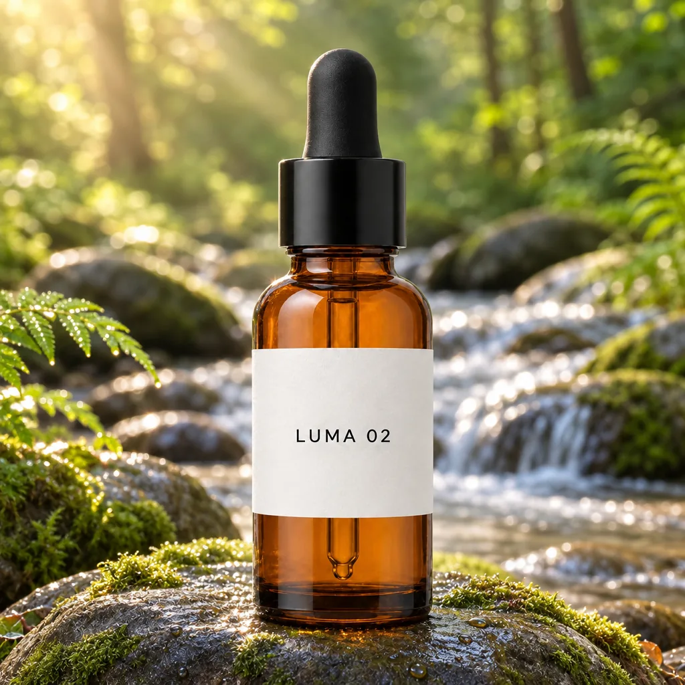

<!-- Generated by scripts/build_readme.py. Edit source data, locale catalogs and generator scripts. -->

# LUMA 02 bottle on a forest river stone

[← Back to external website archive](../../README.md#all-cases)

 

**Creator-reported model · Source-only; not independently reproduced**

An amber LUMA 02 dropper bottle appears on a moss-covered stone beside a sunlit forest stream. The page explicitly identifies the shared packshot input as made with GPT Image 2.5; that file is archived separately as a reference, not counted as a 2.6 output. The output is attributed to a high-quality 2.6 Flare edit. Its duplicate appearance in the page header is counted once. This is not a markup-guidance claim or an independently reproduced fidelity test. Offline recovery review on 2026-11-08 rechecked retained source evidence and original file integrity. Current source availability, animation playback and model execution were not tested.

## Images / GIFs

- [Amber LUMA 02 dropper bottle on mossy river stone with a sunlit forest stream behind](https://zzo.ai/samples/gpt-image-2-6/luma-02-forest-stone.webp) · image
  - Credit: zzo.ai
  - Reuse: source-attributed. Unmodified public-source archival copy with source attribution. An explicit redistribution license was not found. Attribution, public availability and any site copyright notice do not grant permission; the repository MIT license does not cover this file.
  - [Provenance / rights evidence](https://zzo.ai/compare/gpt-image-2-6-vs-gpt-image-2-5)

**Reference/input image, not a generated output.**

- [Reference only: LUMA 02 white-background packshot made with GPT Image 2.5 according to zzo.ai](https://zzo.ai/samples/gpt-image-2-5/luma-02-packshot-input.webp) · image
  - Credit: zzo.ai
  - Reuse: source-attributed. Unmodified public-source archival copy with source attribution. An explicit redistribution license was not found. Attribution, public availability and any site copyright notice do not grant permission; the repository MIT license does not cover this file. The page explicitly attributes this input to GPT Image 2.5; the variant is unspecified for the input. It is not a GPT Image 2.6 output.
  - [Provenance / rights evidence](https://zzo.ai/compare/gpt-image-2-6-vs-gpt-image-2-5)

## Source-page and media access

- Checked: 2026-11-05 (UTC)
- Original page: Accessible. The collector checked source access on 2026-11-05. A prior audit reviewed retained evidence on 2026-11-06, followed by this offline recovery recheck on 2026-11-08. Neither local review establishes current availability.
- Media: Archived locally. The historical direct HTTP output requests returned 403. The dated collector report separately records supported browser saving from the normally accessible page, including the identified LUMA input. This audit made no requests; retained files match the recorded bytes and hashes and passed MIME, frame, pixel and metadata checks.
- [Per-file attempts and results](../../../docs/YEPSHOT_ZZO_RECOVERY_AUDIT_2026-11-08.md)

## Original prompt

[Original prompt at source](https://zzo.ai/compare/gpt-image-2-6-vs-gpt-image-2-5)

The source publishes the actual prompt. This repository links to it rather than inventing or republishing the full text. Required inputs and parameters remain at the source.

## Attribution and verification

- ID: zzo-flare-luma-forest-stone
- Author: zzo.ai
- [Original source](https://zzo.ai/compare/gpt-image-2-6-vs-gpt-image-2-5)
- Model: GPT Image 2.6
- Variant: Flare
- Evidence: A dated 2026-11-05 collector observation maps this exact media URL to the comparison’s individually labelled GPT Image 2.6 output and records Flare, high quality and one first run per prompt. This is zzo.ai’s attributed claim, not independent generation or retained verbatim comparison-page HTML.
- Collected: 2026-11-05 (UTC)
- Source checked: 2026-11-08 (UTC)

Attribution does not grant a media license. Repository MIT terms do not cover third-party outputs. Local files record provenance and reuse status; source-attributed does not mean open-licensed.
